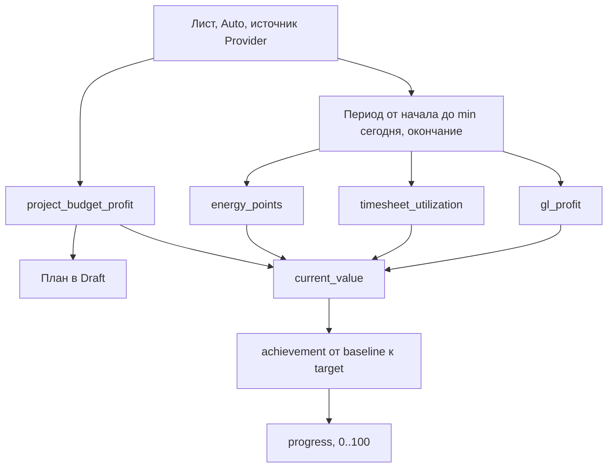
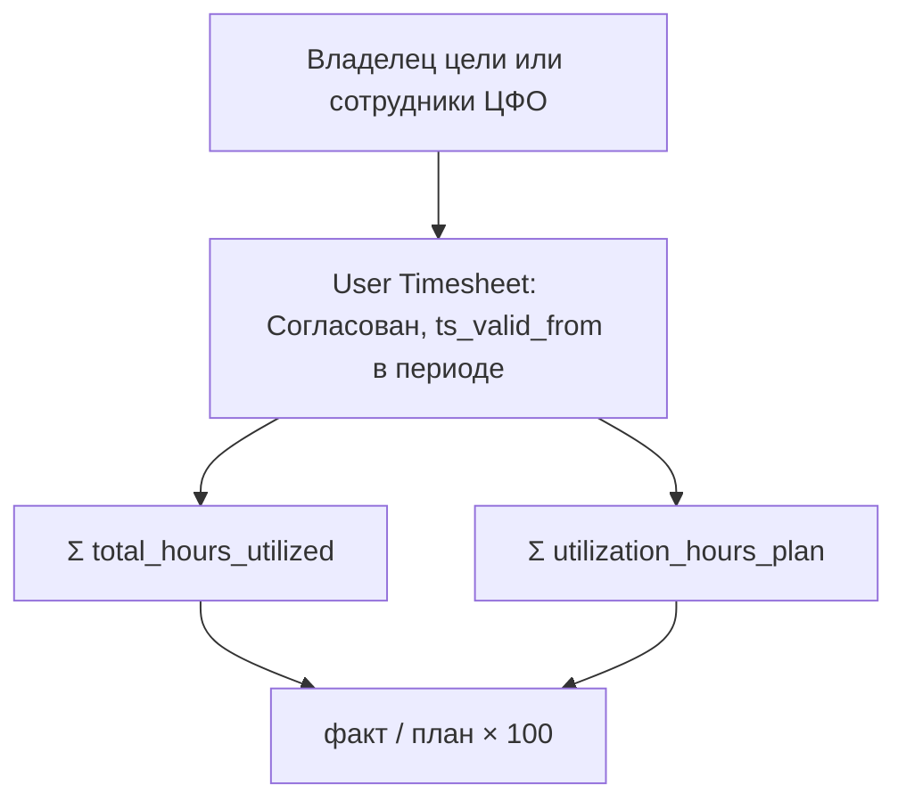
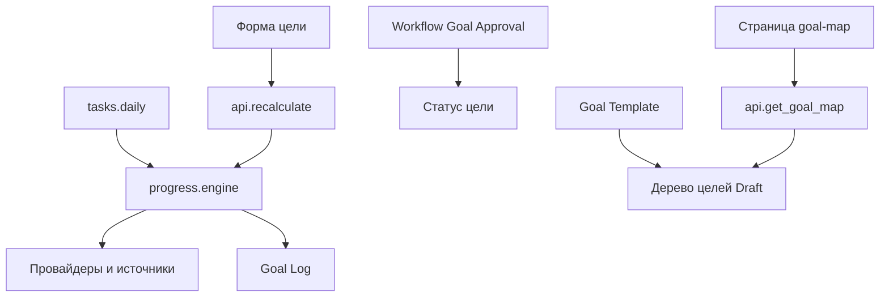

# Dinext Goals

## 📖 Overview

**Dinext Goals** (`dinext_goals`) — приложение Frappe/ERPNext v15 для управления целями в стеке Dinext. Модуль Desk называется **Dinext Goals**. Приложение ставит иерархию целей с несколькими родителями, автоматический расчёт факта и плана, двухшаговое согласование, шаблоны деревьев, рабочую область «Цели» и карту целей.

Обязательные приложения при установке — `dinext_common` и `erpnext` (`required_apps` в `dinext_goals/hooks.py`). Провайдеры прибыли, бюджета проекта и коммерческой утилизации читают данные соседних приложений, если те установлены на сайте; без них соответствующий провайдер сообщает, что источник недоступен.

Репозиторий: `erpnext/dinext/dinext-goals`.

## ✨ Features

- **Цели и типы.** DocType Goal: тема, код, тип, владелец, компания, подразделение, период, вес, приоритет, описание. Типы поставляются фикстурой: OKR, KPI, Project Goal, Personal, Strategic.
- **Иерархия.** Несколько родителей через дочернюю таблицу Goal Parent. Родителем может быть только группа. Циклы запрещены. У группы с методом прогресса Auto прогресс — взвешенное среднее прогресса дочерних целей, процент выполнения — взвешенное среднее их выполнения (без ограничения 100 %); отменённые и цели с нулевым весом в среднее не входят. У группы с ручным прогрессом выполнение равно прогрессу. Цель с несколькими родителями учитывается у каждого.
- **Параметры.** Goal Parameter: Int, Float, Currency, Percent, Data, Select, Date, Check, Link, Link List. Параметр с флагом наследования передаётся потомкам. Своё значение потомка перекрывает родительское. Одинаковый код на одном уровне предков — ошибка. На карточке цели показывается таблица действующих параметров.
- **Метрика.** Источник факта: связанные документы (агрегация с фильтром, в том числе `=param:`), провайдер или правило на Python (`frappe.safe_eval`). План задаётся вручную, провайдером или формулой. Провайдер плана (`target_provider`) может отличаться от провайдера факта.
- **Провайдеры.** Реестр — хук `dinext_goals_metric_providers`. Встроенные четыре провайдера описаны в разделе «Расчёт провайдеров». Другое приложение добавляет свой тем же хуком.
- **Шкала и результат.** Goal Scale: коэффициент берётся по наибольшему порогу, не превышающему процент выполнения. Формула результата считается после свёртки и видит параметры, прямых потомков (`child`) и цели того же дерева (`tree_goal`).
- **План, отклонение, RAG.** Плановый прогресс растёт линейно от даты начала к дате окончания. Отклонение — фактический прогресс минус плановый, в п.п.: положительное при опережении плана, отрицательное при отставании. Красный статус — когда отставание больше красного порога или цель просрочена, жёлтый — когда больше жёлтого. Патч `flip_goal_deviation` перевернул знак у сохранённых целей. Просрочка ставится только целям в статусах Active и On Hold.
- **Согласование.** Workflow «Goal Approval»: Draft → Parent Approval → Finance Approval → Approved. Первый шаг согласуют владельцы родительских целей с ролью Goal Approver, второй — роль Goal Finance Approver. Движок параллельного согласования — `dinext_common`. Статус жизненного цикла (Draft, For Approval, Active, On Hold, Closed, Cancelled) хранится отдельно от `workflow_state`: после утверждения владелец приостанавливает, возобновляет, закрывает или отменяет цель. Расчётные поля исключены из отпечатка раунда согласования.
- **Роли.** Goal Manager, Goal Owner, Goal Approver, Goal Finance Approver. Чтение целей открыто всем четырём ролям. Запись — у Goal Manager, владельца, автора и владельца любой родительской цели.
- **Пересчёт.** Кнопка «Рассчитать прогресс» пересчитывает потомков снизу вверх, саму цель и предков. Ежедневное задание `dinext_goals.tasks.daily` пересчитывает активные цели, если это включено в Goals Settings. Пересчёт не меняет метку изменения документа и не сбрасывает открытый раунд согласования. Изменения пишутся в Goal Log (источник Manual или Auto). На форме — график плана и факта.
- **Шаблоны.** Goal Template описывает дерево целей со сдвигом дат, метриками и параметрами. «Создать цели» спрашивает дату начала, владельца, префикс кода, необязательного родителя и параметры с флагом «спросить при создании». Неотвеченный параметр без значения по умолчанию не создаёт строку, чтобы действовало унаследованное значение. Поддерево цели можно сохранить как новый шаблон. Шаблоны мотивации ИТК (KPI_v6) поставляются фикстурой `dinext_goals/fixtures/goal_template.json`.
- **Рабочая область «Цели».** Девять числовых карточек (все цели, мои, на согласовании, активные, под риском, просроченные, мой средний / максимальный / минимальный прогресс), четыре графика и ярлыки на цели, карту, шаблоны, «Мои согласования» и настройки.
- **KPI на форме цели.** Над графиком плана и факта — плашки с крупными числами: у метрической цели факт (цвет RAG), план, процент выполнения и прогресс с плановым процентом; у группы — выполнение, прогресс, плановый прогресс и отклонение со знаком. Отдельные плашки — коэффициент шкалы и результат формулы, если они заданы.
- **Карта целей.** Страница Desk `goal-map` на ECharts (graph) из `dinext_common`: карточки сверху вниз (по умолчанию) или слева направо, аватар владельца, крупный факт в цвете RAG, полоса прогресса, кнопки сворачивания ветки, миникарта для навигации, карточка связанных документов. При масштабе меньше 0,4 карточка показывает только факт (или прогресс у группы) в цвете RAG. Перетаскивание левой кнопкой работает по всему полю графика. Кнопки: масштаб, «По размеру экрана», «Вписать по ширине», «Вписать по высоте», развернуть и свернуть всё, сохранение картинкой PNG. Вписывание учитывает панель кнопок сверху и легенду снизу. Фильтры: корень, статусы (несколько, по умолчанию Active), период «Период с» — «Период по» по месяцам (любая граница может быть пустой), типы и владельцы (несколько), компания, проект.
- **Цели проекта.** Дочерняя таблица Goal Project (поле `goal_projects`, только чтение) хранит проекты из собственных и унаследованных параметров Link / Link List по Project; она обновляется при сохранении цели и у потомков при смене параметров или родителей. На форме проекта группа «Цели» в «Связях» открывает список целей проекта, меню «Вид» → «Карта целей» открывает карту с фильтром по проекту. Клиентские скрипты сайта, которые заменяют связи проекта, группу «Цели» не убирают: `public/js/project_goals.js` добавляет её при каждой отрисовке.
- **Демо.** `dinext_goals.demo.motivation_itk` создаёт и удаляет дерево целей по мотивации ИТК (III квартал закрыт, IV активен) по шаблонам из фикстуры. Для утилизации демо создаёт или пересчитывает недельные табели User Timesheet (с разрывом на границе месяца) и согласует их; при удалении созданные табели удаляются, а найденные возвращаются к прежним суммам и статусам. Повторный запуск не плодит дубли.
- **Локализация.** Пользовательские строки переведены в `dinext_goals/translations/ru.csv`.

## 📐 Расчёт провайдеров

Провайдер вызывается, когда у листа метод прогресса Auto и источник факта — Provider. Период один на все провайдеры факта. План провайдер отдаёт отдельно и только если у него есть `get_target`. Из встроенных план считает только `project_budget_profit`. Пустой `target_provider` при источнике плана Provider означает провайдер факта. Такой план перезаписывается только в статусе Draft; после отправки на согласование записанное значение не меняется.

Период факта — от плановой даты начала до более ранней из сегодня и плановой даты окончания. Без даты начала факт провайдером не считается.

```
date_from = exp_start_date
date_to   = min(сегодня, exp_end_date)    # если даты окончания нет — сегодня
date_to   = max(date_from, date_to)
```

Дальше движок считает процент выполнения и прогресс. Для Boolean факт ненулевой даёт 100, иначе 0. Иначе:

```
achievement = (current_value − baseline) / (target − baseline) × 100
```

Если план равен базе, achievement равен 100 при факте, равном плану, и 0 в остальных случаях. Процент не ограничивается. Прогресс листа — этот процент, обрезанный до отрезка от 0 до 100.



### `gl_profit` — валовая прибыль по проводкам

Параметры: `cost_center` (Link на Cost Center) и `projects` (Link List на Project). Нужен хотя бы один. Если заданы оба, берутся только проекты: проводки проектной цели часто лежат на общем ЦФО, а ЦФО цели наследует от ветки.

Отбор GL Entry, `posting_date` внутри периода:

- `is_cancelled = 0`. При отмене документа флаг ставится и на исходные строки, и на зеркальные, поэтому отменённый документ выпадает целиком. При неизменяемом журнале (Immutable Ledger) зеркальные строки остаются активными с датой отмены и гасят исходные, если обе даты попадают в период. Сторнирующий Journal Entry учитывается как обычный документ и гасит исходный так же.
- Без Period Closing Voucher: он обнуляет счета доходов и расходов при закрытии года.
- Без вступительных проводок (`is_opening = Yes`): это остатки, а не обороты периода.
- Книга учёта (`finance_book`) пустая или книга по умолчанию компании цели.
- Компания цели, если она задана. Без компании все проводки должны быть в одной валюте компаний, иначе расчёт останавливается с ошибкой.
- При непустом `projects` — `project` из этого списка. Иначе — `cost_center` самой записи и всех потомков по дереву ЦФО (`lft`/`rgt`).

Суммы группируются по счёту и компании. Счета с другим `root_type` не входят в сумму.

```
прибыль = Σ по Income (credit − debit) − Σ по Expense (debit − credit)
```

Плана этот провайдер не даёт.

### `project_budget_profit` — плановая прибыль по бюджету проекта

Параметр `projects` обязателен. Нужны таблицы Project Budget и Project Budget Amount (`dinext_projects_pl`). Без них провайдер недоступен.

Строки Project Budget Amount помесячные (`pba_year`, `pba_month`). Месяц входит в сумму, если пересекается с периодом. Факт (`get_value`) берёт период факта, план (`get_target`) — плановый период цели от `exp_start_date` до `exp_end_date`; без одной из дат плана суммируются все месяцы. Нет бюджетов — 0.

```
план = Σ по Income pba_plan − Σ по Expense pba_plan, месяцы (год, месяц) пересекаются с периодом
```

Например, цель с 15.05 по 30.09 берёт бюджет с мая по сентябрь включительно. На цели проектного бонуса факт обычно считает `gl_profit`, а план — этот провайдер.

### `timesheet_utilization` — коммерческая утилизация

Нужна таблица User Timesheet (`dinext_timesheets`). Провайдер не считает часы сам: табель хранит утилизированные часы и план утилизации, их пересчитывает `calculate_ut_hours` при сохранении табеля.

Параметр `scope`: `user` (по умолчанию) — владелец цели; `team` — сотрудники ЦФО из параметра `cost_center` (для команды параметр обязателен). Сотрудник входит в команду, если его последнее назначение ЦФО с `cct_valid_from` не позже конца периода попадает в этот ЦФО или его потомков.

Берутся табели со статусом «Согласован» (`ut_status`), у которых `ts_valid_from` попадает в период: табель относится к периоду, в котором начинается. Факт — отношение сумм на весь состав, а не среднее процентов отдельных табелей или сотрудников, поэтому короткий табель весит меньше полного. Нулевой план даёт 0.

```
утилизация = Σ total_hours_utilized / Σ utilization_hours_plan × 100
```



Плана этот провайдер не даёт: целевые 100% задаются на цели отдельно.

### `energy_points` — баллы активности

Параметров нет. Считается сумма `points` в Energy Point Log владельца цели за период, включая весь последний день. Не входят строки с типом Review и отменённые (`reverted`).

```
баллы = Σ points, где user = goal_owner, type ≠ Review, reverted = 0
```

Плана этот провайдер не даёт.

## 🚀 Installation

Нужен [bench](https://github.com/frappe/bench) с сайтом на Frappe и ERPNext v15. До установки этого приложения на сайте должны стоять `erpnext` и `dinext_common`.

```bash
cd $PATH_TO_YOUR_BENCH
bench get-app https://dinext.gitlab.yandexcloud.net/erpnext/dinext/dinext-goals.git --branch develop
bench --site your_site.local install-app dinext_goals
bench --site your_site.local migrate
bench build --app dinext_goals
bench --site your_site.local clear-cache
```

Если приложение уже есть в `apps` и добавлено в `sites/apps.txt`, достаточно `install-app` (или `migrate` на сайте, где оно установлено). После установки назначьте роли целей пользователям.

## 🛠️ Usage

1. Откройте рабочую область **Цели**. Карточки считают цели по своим фильтрам: отменённые не входят, «Мои цели» — только цели, где текущий пользователь владелец.
2. Создайте **Goal**. Укажите тему, тип, владельца и период. Группу отметьте «Is Group» и задайте родителей в таблице Parent Goals. Для листа выберите источник факта и план.
3. Назначьте параметры на цели. Потомки с флагом наследования получат их, пока не зададут своё значение.
4. Нажмите **Рассчитать прогресс**. Обновятся факт, план, процент выполнения, прогресс, RAG и, для группы, свёртка. Точки появятся в Goal Log и на графике формы.
5. Владелец отправляет черновик на согласование (**Submit for Approval**). После Approved статус становится Active. Дальше владелец может приостановить, возобновить, закрыть или отменить цель.
6. В **Goal Template** нажмите **Создать цели** и заполните диалог. Корень созданного дерева откроется в статусе Draft. **Сохранить как шаблон** на цели записывает её поддерево в новый шаблон.
7. Страница **Карта целей** (`/app/goal-map`) рисует дерево от корня. Параметр адреса `root` задаёт корень, `project` — проект. По умолчанию видны только активные цели; фильтр периода оставляет цели, чей плановый период пересекается с месяцами от «Период с» до «Период по». С заданным корнем типы, владельцы, компания и проект не применяются: они выбирают деревья, когда корня нет. Если родитель не проходит фильтр, подходящие потомки поднимаются на его место. Клик по карточке открывает цель, по кнопке «+» / «−» — сворачивает ветку, по карточке связанных документов — их список. Расположение (сверху вниз или слева направо) запоминается в браузере.

Демо-дерево и его удаление:

```bash
bench --site your_site.local execute dinext_goals.demo.motivation_itk.setup
bench --site your_site.local execute dinext_goals.demo.motivation_itk.teardown
```

Проверки:

```bash
bench --site your_site.local run-tests --app dinext_goals
bench --site your_site.local run-ui-tests dinext_goals --headless
```

## 📦 Technologies

- **Backend:** Python 3.10+, Frappe, ERPNext v15
- **Frontend:** JavaScript Desk (`goal.js`, `goal_template.js`, страница `goal-map`), CSS Desk, ECharts из `dinext_common`
- **Согласование:** workflow Frappe и движок `dinext_common`
- **Проверки:** тесты `FrappeTestCase`, Cypress, ruff (`pyproject.toml`)

## 🔧 Configuration

Отдельного файла настроек и переменных окружения у приложения нет. Пороги и расписание задаёт одиночный документ **Goals Settings**:

- жёлтый порог отклонения, по умолчанию 10 п.п.;
- красный порог отклонения, по умолчанию 25 п.п.;
- ежедневный пересчёт активных целей;
- показ связанных документов на карте целей по умолчанию.

Роли, состояния workflow, действия workflow, workflow «Goal Approval», типы целей и шаблоны целей мотивации ИТК поставляются фикстурами из `dinext_goals/hooks.py` и каталога `dinext_goals/fixtures/`. Числовые карточки, графики, рабочая область и страница карты — JSON модуля. Карточки хаба Dinext добавляет `dinext_goals/install.py`.

Свой провайдер метрики регистрируется хуком `dinext_goals_metric_providers`: ключ и путь к объекту с подписью, объявлением параметров и методом расчёта.

Пароль пользователей Cypress генерируется на прогон в `cypress.config.js` и в репозитории не хранится.

## ✅ Requirements

- Bench, Frappe и ERPNext v15
- Python >= 3.10
- `dinext_common` и `erpnext` — обязательны для установки
- Для провайдеров на сайте нужны данные соседних приложений: `dinext_projects` и `dinext_projects_pl` (прибыль и бюджет проекта), `dinext_timesheets` (утилизация). В `required_apps` их нет: без них приложение ставится, а провайдер сообщает, что источник недоступен
- Для UI-тестов — Cypress, который поднимает `bench run-ui-tests`

## 🤝 Contributing

Разработка ведётся через OpenSpec в репозитории `dinext-docs`. Порядок для агента и разработчика — в [AGENTS.md](AGENTS.md). Store указан в `openspec/config.yaml` (`store: dinext-docs`).

Проверка стиля Python — ruff, настройки в [pyproject.toml](pyproject.toml):

```bash
ruff check dinext_goals
ruff format --check dinext_goals
```

CI подключается из `dinext_control_center`, файл `ci/dinext-app.yml` (см. [.gitlab-ci.yml](.gitlab-ci.yml)). Политики CI в этот репозиторий не копируются.

## 📄 Documentation

- [AGENTS.md](AGENTS.md) — порядок работы с центральными инструкциями Dinext и OpenSpec.
- Change `add-goal-management` в Store `dinext-docs` — постановка и спецификации этой функции.
- Статья «Цели» в пользовательской документации `dinext-docs` помечена как находящаяся в разработке и эту функцию ещё не описывает. Её обновляют отдельным doc-proposal, не этим README.

## ❤️ Acknowledgements

- **Dinext** — издатель приложения
- **Frappe Framework** и **ERPNext**
- **Apache ECharts** — график плана и факта на форме цели

## 📝 Changelog

По истории git на момент написания README в репозитории два коммита:

- `6ce0d47` — каркас Frappe-приложения.
- `a297074` — навигация агента (`AGENTS.md`), копии команд OpenSpec и заготовка Cypress.

Реализация управления целями (DocType, расчёт, согласование, рабочая область, карта, тесты и демо) в истории git ещё не зафиксирована. Раздел «Возможности» описывает текущее дерево исходников, а не эти два коммита.

## 🗂️ Repository Structure

```
dinext-goals/
├── .cursor/commands/          # Копии slash-команд OpenSpec, источник — dinext-docs
├── .gitlab-ci.yml             # Подключение CI dinext_control_center
├── AGENTS.md                  # Указатель на центральные инструкции
├── README.md
├── cypress.config.js          # Прогон UI-тестов, случайный пароль на запуск
├── cypress/                   # Сценарии карты, рабочей области, пересчёта, шаблона
├── license.txt                # GNU GPL v3
├── openspec/config.yaml       # store: dinext-docs
├── pyproject.toml             # Метаданные пакета и ruff
└── dinext_goals/              # Корень приложения Frappe
    ├── hooks.py               # Зависимости, фикстуры, права, планировщик, провайдеры
    ├── install.py             # after_install / after_migrate, карточки хаба
    ├── api.py                 # Пересчёт, статус, график, карта
    ├── constants.py           # Имена DocType, ролей, статусов
    ├── parameters.py          # Наследование, действующие параметры, проекты цели
    ├── integrations/project.py # Группа «Цели» в связях Project
    ├── templates.py           # Создание дерева из шаблона и обратное сохранение
    ├── tasks.py               # Ежедневный пересчёт
    ├── modules.txt
    ├── patches.txt
    ├── patches/v1_0/          # Знак отклонения, заполнение Goal Project
    ├── goals/                 # Иерархия, согласующие, жизненный цикл, права
    ├── progress/              # Метрики, источники, формулы, свёртка, шкала, движок
    ├── providers/             # gl_profit, project_budget, timesheet_utilization, energy_points
    ├── demo/motivation_itk.py # Идемпотентное демо и его удаление
    ├── fixtures/              # Role, Workflow, Goal Type, Goal Template
    ├── translations/ru.csv
    ├── tests/                 # FrappeTestCase и подготовка данных Cypress
    ├── public/                # CSS, бандл карты целей, скрипт формы Project
    └── dinext_goals/          # Модуль Desk
        ├── doctype/           # Goal, параметры, проекты, шкала, журнал, шаблон, настройки, тип
        ├── workspace/цели/
        ├── number_card/
        ├── dashboard_chart/
        └── page/goal_map/
```

- **goals/** — обход родителей и проверка цикла, список согласующих, перевод workflow в статус, `has_permission`.
- **progress/** — чистый расчёт и запись изменившихся полей плюс строки Goal Log. Точка входа пересчёта — `progress/engine.py`.
- **providers/** — доступ к проводкам, бюджету проекта, табелям и Energy Point Log. Реестр собирает `providers/__init__.py` из хука.
- **dinext_goals/dinext_goals/** — JSON и контроллеры DocType, рабочая область, карточки, графики и страница карты.
- **cypress/** — сценарии `goal-analytics`. Пользователей создаёт `dinext_goals/tests/ui_test_helpers.py` и удаляет после прогона.

## 🔗 Flow Chart

Пересчёт, согласование, шаблон и карта не смешивают друг друга: расчёт пишет факты и журнал, workflow меняет состояние согласования, статус после утверждения меняет владелец.



- Форма и ежедневное задание вызывают движок. Движок обходит потомков, считает факт и план, сворачивает группы и пишет Goal Log.
- Workflow «Goal Approval» доводит черновик до Approved. Контроллер выставляет статус. Дальше владелец меняет статус методами жизненного цикла, без нового раунда согласования.
- Шаблон создаёт дерево целей одним сохранением. Карта читает уже сохранённое дерево через `api.get_goal_map`.

## License

GNU GPL v3. Текст — в [license.txt](license.txt).
