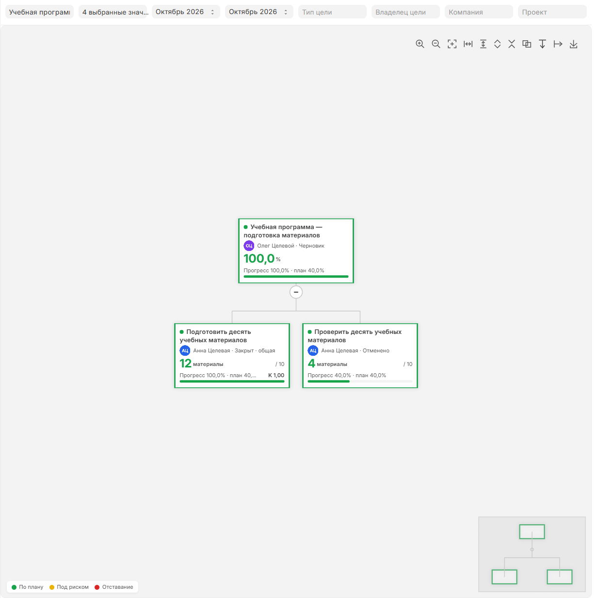

[Русский](README.ru.md)

<!-- dinext-presentation:start -->
<p align="center">
  <a href="https://dinext.ru"></a>
</p>
<h1 align="center">Dinext Goals</h1>

<hr>

<p align="center">Define goals and metrics, organize goal campaigns and track results through goal maps and approvals.</p>

<p align="center">
  
</p>
<p align="center"><sub>Goal-map example from the Dinext platform documentation.</sub></p>

<p align="center">
  <a href="https://dinext.ru">Website</a> · <a href="https://docs.dinext.ru">Documentation</a>
</p>
<!-- dinext-presentation:end -->

# Dinext Goals

A Frappe application for the ERPNext Dinext stack. A product app scaffold: the `Dinext Goals` module, without DocTypes.

Repository: `erpnext/dinext/dinext-goals`.

## Dependencies

- `dinext_common`
- `erpnext`

## Installation

```bash
cd $PATH_TO_YOUR_BENCH
bench get-app https://dinext.gitlab.yandexcloud.net/erpnext/dinext/dinext-goals.git --branch develop
bench install-app dinext_goals
```
